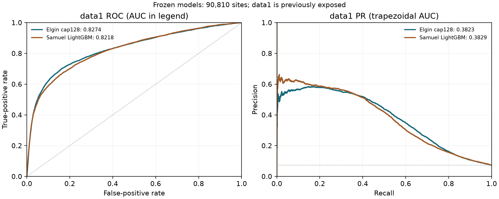
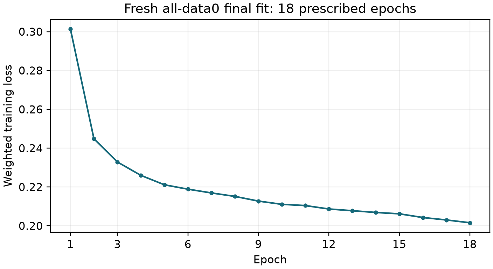

# Final cap128 model: actual training, predictions and evaluation

**Task 1: final fitting, three supplied-dataset predictions and frozen data1
evaluation are complete.** Elgin cap128 has the higher data1 combined score in
this measured comparison. This does not establish universal superiority or
performance on the new unlabelled test set.

The final artifact is [the saved model](../artifacts/cap128_weight3_v1/model.pt),
SHA256 `b2d38ff29a918cb6213ad7df2c76786c5f56d3640bd055ff179d211b0e979668`. It was fitted afresh on **121,838 data0 sites,
5,475 positives and 3,852 genes** for the prescribed 18 epochs. It uses
normalisers learned on data0 and no data1, data2 or SG-NEx fitting. The same
unchanged artifact generated all three application files.

## Actual comparison with Samuel's LightGBM

Data0 validation uses the exact shared five gene folds: a gene is held out
with all its sites, including sites from different transcripts of that gene.
Inner training-gene validation selected duration, followed by fresh refitting
within each outer training partition. Primary S is the unweighted mean of
five `(ROC AUC + trapezoidal PR AUC)/2` values. The final all-data0 prediction
file is **fitted-data output, not validation**.

| Pipeline | Mean ROC AUC | Mean PR AUC | Mean S |
| --- | ---: | ---: | ---: |
| Elgin cap128 | 0.931828 | 0.505601 | 0.718715 |
| Samuel LightGBM | 0.921897 | 0.498996 | 0.710446 |

Data1 is a **previously exposed transfer diagnostic**, not a blind final test.
The final model and its 18-epoch duration were fixed before these predictions;
this result does not select another model, epoch or threshold. Both models
cover the same 90,810 sites, including 6,593 positives.

| Frozen pipeline | ROC AUC | PR AUC | S |
| --- | ---: | ---: | ---: |
| Elgin cap128 | 0.827381 | 0.382350 | 0.604866 |
| Samuel LightGBM | 0.821764 | 0.382879 | 0.602322 |

At the shared working cutoff 0.5:

| Pipeline | Precision | Recall | F1 | Specificity | Accuracy |
| --- | ---: | ---: | ---: | ---: | ---: |
| Elgin cap128 | 0.484693 | 0.444259 | 0.463596 | 0.963024 | 0.925361 |
| Samuel LightGBM | 0.579131 | 0.226452 | 0.325592 | 0.987117 | 0.931891 |

On data1, Elgin's higher metrics are roc_auc, selection_score, recall, f1. Samuel's higher metrics
are pr_auc_trapezoid, average_precision, precision, specificity, accuracy. These point estimates use the same rows and scoring
implementation; no significance or repeat-seed guarantee is claimed. Accuracy
alone can hide missed positives because only 7.260% of data1 sites are positive.
Average precision (AP) is retained separately in the CSV/JSON; it is not the
trapezoidal PR AUC used in S.



## What this model learns

This is a **sequence-aware attention multiple-instance neural network**.
Each candidate site is a bag of reads with one site label. Each read contains
nine measurements: dwell time, signal SD and mean signal at each of three
neighbouring events. The seven-base sequence is embedded into 28 learned
features and joined to each read's nine transformed/normalised measurements.
A two-layer width-48 encoder represents each read. Gated attention, mean and
SD of those representations are combined with the sequence and **63 all-read
distribution summaries**: nine means, nine population SDs and five quantiles
(10th, 25th, 50th, 75th and 90th percentiles) for each of nine measurements.
A 235-to-48-to-24-to-1 classifier returns a sigmoid site score.

The architecture is a project-specific MIL pipeline, not an exact reimplementation
of published m6Anet. Attention weights are not a validated per-read modification
label or a causal biological explanation. `context_mode=none` disables only
the extra proposed relative-reference branch; it does **not** remove the
seven-base sequence or the existing summaries.

Final settings: AdamW, learning rate0.001, weight decay0.0001, positive-class
loss weight3, dropout0.25, seed2026, batch256 and four CPU threads. Training
samples at most128 reads per site; **prediction uses all available reads**.
All valid sites are retained, including unusual signals and difficult
high-coverage sites. The 18-epoch prescription is the median of inner choices
9/20/19/18/17, fixed before the fresh final fit.



This curve shows the completed training objective only; it contains no
validation series and does not show unseen-data improvement across epochs.
Epoch checkpoints, optimizer/RNG state, history and console logs remain in
local ignored `model_elgin/outputs/read_cap_v1/final/none/`.

## EDA, model progression and limits

Member 1's findings affected gene-separated evaluation, retaining valid
unusual sites and testing sequence context, read-depth stability and
high-coverage errors. The added relative-context branch reduced mean S to
0.708885; that negative result remains documented. Increasing the read cap
32-to-128 raised mean S0.717642-to-0.718715, while fixed-cutoff metrics were
slightly worse. Removing positive loss weighting gave S0.718381 and reduced
recall/F1 at0.5; weight3 was retained. A training-side cutoff study did not
deliver a convincing F1 gain, so **0.5 remains a working reporting cutoff**,
not a fitted probability calibration or biological modification threshold.
See [the fixed nomination](../FINAL_MODEL_SELECTION.md) and the linked
diagnostic reports in [the model guide](../README.md).

The separate external experiment has higher data0 S0.726644, but was not
promoted after its recorded recall/subgroup/stability tradeoffs. Retaining
cap128 is a conservative documented choice, not proof it is globally best.
Repeated development comparisons make the data0 score optimistic as a
generalisation estimate. Grouping excludes identical genes across folds;
it does not establish homology-family or external-cell-line independence.

These are m6A candidate-site scores. They do not establish other RNA marks,
modified-molecule fractions or causal cell-line biology. Data2 has fractional
labels and is not silently converted into the same binary evaluation.
No final-model SG-NEx predictions, clean AWS Ubuntu execution, new unlabelled
test submissions or finished Task2 report/explorer are claimed here.

## Verified prediction files and measured computation

| Dataset | Sites | Reads used | Wall seconds | Process CPU seconds | Sampled peak tree RSS MiB |
|---|---:|---:|---:|---:|---:|
| data0 | 121,838 | 11,027,106 | 117.283 | 453.438 | 377.32 |
| data1 | 90,810 | 7,907,952 | 86.679 | 334.547 | 369.39 |
| data2 | 1,323 | 1,171,940 | 10.294 | 34.891 | 365.04 |

All CSVs contain exactly `transcript_id,transcript_position,score`, unique
input keys, finite scores in[0,1] and complete input-site coverage. Their
manifests agree on the model SHA above and record `labels_read=false`,
`all_reads_used=true` and `stage=final_data0`. Full CSVs and console logs remain
local under `model_elgin/outputs/final_cap128_v1/`; `summary.json` retains
their hashes, counts and timing evidence. Data0 scores here are training-data
predictions. Data2's1,323 rows are predictions without a binary AUC claim.

Final-fit wrapper: **679.823s wall (11.33min), 2614.312s process CPU,
938.30MiB sampled peak process-tree RSS**,0sampling errors at0.2s sampling.
This includes preflight and core delegation and overlaps core fit timers;
do not add the two. Inference timings include model/input hashing/loading,
full parsing, prediction, CSV writing and verification, excluding Python
imports. Training cache construction, historical CV/search, environment
setup, report generation and clean-host checks are outside these final-fit
and inference totals. CPU/RSS scopes differ from Samuel's received training
measurements, so these are not matched algorithm-speed comparisons.

## Exact commands

These commands run from the repository root. The actual Windows interpreter
was `../advanced_model/.venv/Scripts/python.exe`; `python` below is its portable
replacement in the pinned Python3.12 environment. Installation and public
fresh-training instructions are in [FINAL_MODEL_USAGE.md](../FINAL_MODEL_USAGE.md).

```text
python -B model_elgin/tools/final_fit_cap128.py --check-only
python -B -u model_elgin/tools/final_fit_cap128.py --fit
python -B model_elgin/tools/package_final_cap128.py
python -B model_elgin/train_final.py --input ../data0/dataset0.json.gz --labels ../data0/data.info.labelled --output-dir model_elgin/outputs/public_final_check --cache ../advanced_model/cache/data0 --check-only
python -B -u model_elgin/context_reference_v1/predict.py --input ../data0/dataset0.json.gz --model model_elgin/artifacts/cap128_weight3_v1/model.pt --output model_elgin/outputs/final_cap128_v1/data0_predictions.csv --threads 4
python -B -u model_elgin/context_reference_v1/predict.py --input ../data1/dataset1.json.gz --model model_elgin/artifacts/cap128_weight3_v1/model.pt --output model_elgin/outputs/final_cap128_v1/data1_predictions.csv --threads 4
python -B -u model_elgin/context_reference_v1/predict.py --input ../data2/dataset2.json.gz --model model_elgin/artifacts/cap128_weight3_v1/model.pt --output model_elgin/outputs/final_cap128_v1/data2_predictions.csv --threads 4
python -B model_evaluation/evaluate.py --dataset data1 --labels ../data1/data.info --predictions model_elgin/outputs/final_cap128_v1/data1_predictions.csv --output model_elgin/outputs/final_cap128_v1/data1_metrics.json
python -B model_elgin/tools/report_final_cap128.py
```

The report command performs independent file rescoring and receipt checks;
it never trains or predicts. It requires all source outputs to have completed
and refuses an existing nonempty report directory. Use `--output-dir` with
a fresh path to retain a later verification. Ubuntu installation and numeric
parity remain pending; actual native Windows inference and the ten-site
real software example have passed. New unlabelled-test filenames and inputs
must follow the instructions supplied with that release; these three supplied
datasets do not substitute for that submission.
