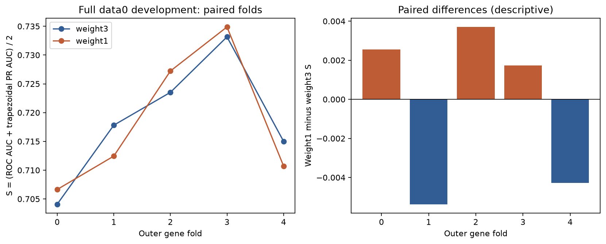
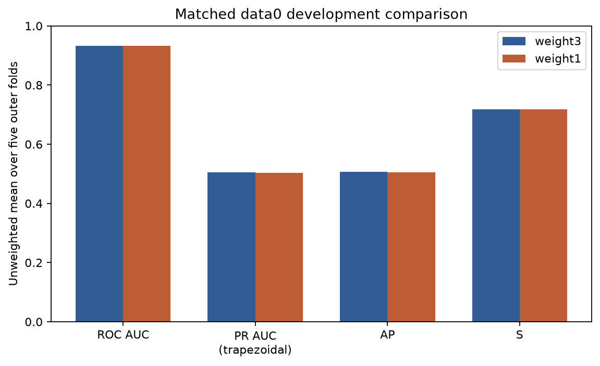

# Positive-loss-weight comparison: cap128

**Weight3 has the higher measured mean data0 development score.**

Weight1 minus weight3 mean S: **-0.0003333186**. Every completed outcome is retained, including declines. This is a bounded loss-objective ablation, not proof of universal superiority.

The reporter validates complete saved five-fold metrics, actual gene split lists, signatures and byte fingerprints for all 121,838 data0 sites and 5,475 positive labels. It reads label-free fold metadata and saved receipts only: no labels, signal arrays or data1; no model deserialisation, fitting, inference or label-based rescoring.

## Actual ranking evidence

The primary score is the unweighted mean of five fold S values, where S=(ROC AUC+trapezoidal PR AUC)/2. AP is a separate summary; pooled OOF ranking is supplementary.

| Positive loss weight | Summary | ROC AUC | Trapezoidal PR AUC | AP | S |
|---|---|---:|---:|---:|---:|
| weight3 | Mean fold | 0.9318281774 | 0.5056010366 | 0.5062502328 | 0.7187146070 |
| weight3 | Sample SD ddof1 | 0.0067647742 | 0.0149215469 | 0.0151078036 | 0.0107261308 |
| weight3 | Pooled OOF | 0.9310519604 | 0.5020558540 | 0.5022134381 | 0.7165539072 |
| weight1 | Mean fold | 0.9332097437 | 0.5035528330 | 0.5042156259 | 0.7183812884 |
| weight1 | Sample SD ddof1 | 0.0057313500 | 0.0186071510 | 0.0186301496 | 0.0120633325 |
| weight1 | Pooled OOF | 0.9327132991 | 0.5022654544 | 0.5024235617 | 0.7174893768 |

## Paired changes

| Metric | Mean weight1 minus weight3 | Sample SD of paired changes | Folds higher / lower / equal |
|---|---:|---:|---|
| roc_auc | +0.0013815664 | 0.0025585990 | 3 / 2 / 0 |
| pr_auc_trapezoid | -0.0020482036 | 0.0065492407 | 2 / 3 / 0 |
| average_precision | -0.0020346069 | 0.0063324680 | 2 / 3 / 0 |
| selection_score | -0.0003333186 | 0.0041802730 | 3 / 2 / 0 |

| Outer fold | Weight3 S | Weight1 S | Difference | Selected epochs: weight3 / weight1 |
|---|---:|---:|---:|---|
| 0 | 0.7040824760 | 0.7066413460 | +0.0025588700 | 9 / 16 |
| 1 | 0.7178109673 | 0.7124420370 | -0.0053689303 | 20 / 16 |
| 2 | 0.7235158931 | 0.7272206655 | +0.0037047724 | 19 / 20 |
| 3 | 0.7331542465 | 0.7348798813 | +0.0017256348 | 18 / 18 |
| 4 | 0.7150094521 | 0.7107225121 | -0.0042869400 | 17 / 19 |

## Decisions at the existing 0.5 reporting cutoff

These are pooled OOF counts, not mean counts or separately optimised operating points. Scores are uncalibrated; removing positive weighting does not establish calibrated probabilities. The prior weight3 threshold experiment does not validate a weight1 cutoff. This report fits or promotes no cutoff/calibrator.

| Positive loss weight | TN | FP | FN | TP | Precision | Recall | F1 | Specificity | Accuracy |
|---|---:|---:|---:|---:|---:|---:|---:|---:|---:|
| weight3 | 112630 | 3733 | 2112 | 3363 | 0.47392897 | 0.61424658 | 0.53504097 | 0.96791936 | 0.95202646 |
| weight1 | 115310 | 1053 | 3630 | 1845 | 0.63664596 | 0.33698630 | 0.44070226 | 0.99095073 | 0.96156372 |

## Controlled change and assessment boundary

Only positive loss weight changes from 3 to 1. Both retain training cap128, width 48, dropout 0.25, AdamW learning rate 0.001, weight decay 0.0001, seed 2026, batch 256, four CPU threads, maximum 20 inner epochs and patience 5. Seven-base conditioning, read attention and 63 all-read distribution summaries are unchanged. Training samples at most 128 reads; summaries, validation and prediction use all reads. No sites are removed or relabelled.

For assessment fold f, inner validation is (f+1)%5: fit the other three groups, select duration on the inner group, initialise fresh weights and refit four non-assessment groups for that duration, then assess f. Inner-selected durations may differ because the stopping policy, rather than its outcome, is held fixed. References/normalisers stay inside each fit. Actual audit gene sets and counts match the immutable label-free shared-fold file; fit signatures are reconstructed with the declared original library versions.

Candidate identity retains all nine parent cap128 source hashes and both old wrapper/plan fields, adding exactly the loss-study wrapper and plan hashes. Current canonical LF source contents are checked against all eleven declared hashes. Signatures and hashes corroborate provenance; they do not independently replay training.

## Measured computation

| Weight | Completed fits | Resource records | Interrupted/failed records | Recovered lower-bound snapshots | Recorded fitting wall seconds | Recorded process CPU seconds | Largest sampled process-tree RSS MiB |
|---|---:|---:|---:|---:|---:|---:|---:|
| weight3 |10|11|1|1|5940.261|18959.219|977.262|
| weight1 |10|10|0|0|5658.540|21591.812|973.098|

**Recorded fitting totals contain lower bounds.** Recorded fitting totals include recovered checkpoint snapshot lower bounds. Unmeasured work after the identified checkpoint epochs and before interruption is omitted. Each recovered snapshot and each resumed invocation is counted once; complete.json cumulative snapshots are not added again.

- weight3, fold 2 inner: recovered epoch 3 snapshot index 0, checkpoint SHA256 `d93d4ecbf7b868b917a0df48c73bd443121932262bd8556df701036e08c21a25`. Counted once: 88.151415600 wall seconds and 329.921875000 CPU seconds. Unmeasured work after epoch 3 and before the pause is omitted; later resumed invocations are separate.

Totals sum each retained per-fit invocation once, including interruptions. Cumulative complete.json snapshots are not added again. Wall sums describe retained fitting work, excluding startup, imports, hashing, outer prediction and orchestration outside fit timers. Memory is the largest retained sampled process-tree RSS, not an additive or exact operating-system peak. Unrecorded work/peaks remain unknown. Reporter work is separate in the manifest.

## Limits and remaining work

- The same development folds and previously selected architecture have been used repeatedly. One seed and five overlapping training sets do not establish seed stability, independent biological replication, statistical significance or a universal best model. Sample SD is descriptive, not a confidence interval.
- Overall metrics do not establish subgroup improvements, biological mechanisms, calibration or molecule-level modification fractions. Preserve negative findings. The higher-S pipeline remains only a candidate until an explicit nomination decision.
- No new final all-data0 fit, data1 transfer result, same-model dataset CSVs, published m6Anet benchmark, genuine 23-run SG-NEx predictions, final explorer or Ubuntu verification is produced by this comparison.

## Exact reporter command

From the repository root after all five folds complete:

```powershell
../advanced_model/.venv/Scripts/python.exe -B model_elgin/tools/report_loss_weight.py
```

The following recorded full-CV wrapper arguments include original and resumed invocations. The interpreter prefix is the documented local environment. These are training commands already executed, not commands executed by this reporter.

weight3: `cv_arguments_1792487318167985900.json`

```powershell
../advanced_model/.venv/Scripts/python.exe -B -u model_elgin/tools/train_read_cap.py '--phase' 'cv'
```

weight3: `cv_arguments_1792545080560498200.json`

```powershell
../advanced_model/.venv/Scripts/python.exe -B -u model_elgin/tools/train_read_cap.py '--phase' 'cv'
```

weight1: `cv_arguments_1792568689316683100.json`

```powershell
../advanced_model/.venv/Scripts/python.exe -B -u model_elgin/tools/train_loss_weight.py '--phase' 'cv'
```

comparison_manifest.json pins roots, actual reporter arguments, sources, every checked input/output and resource recovery disclosures. Existing weight3/weight1 artifacts are not changed.




