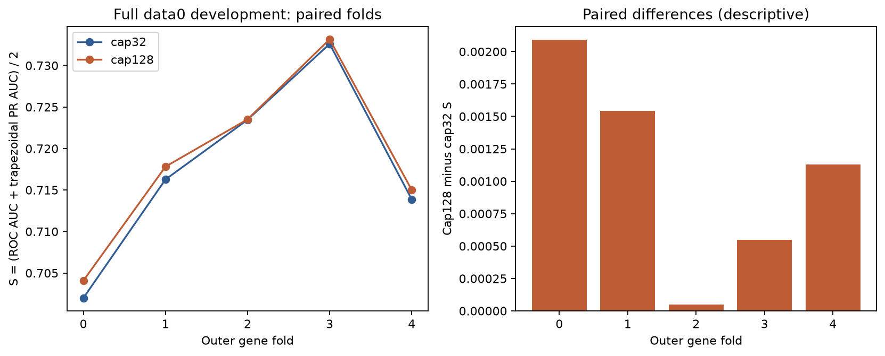
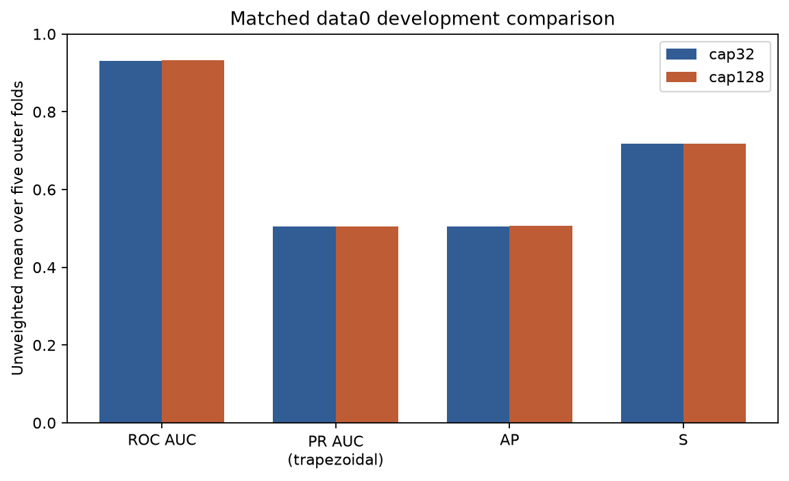

# Training read-cap comparison

**Cap128 has the higher measured mean data0 development score.**

Cap128 minus cap32 mean S: **+0.0010727781**. All completed outcomes are retained, including negative changes. This is a bounded architecture-development experiment, not proof of universal superiority.

This report checks completed saved five-fold results, split audits, prediction/artifact byte hashes and resource records. It does not read labels, load weights, fit a model, run inference, or evaluate data1. The figures and tables cover all 121,838 data0 sites and 5,475 positive site labels.

## Ranking metrics

The primary criterion is the unweighted mean of five fold-level S values, where S = (ROC AUC + trapezoidal PR AUC) / 2. Average precision (AP) is separate from trapezoidal PR AUC. Pooled OOF values are supplementary.

| Training cap | Summary | ROC AUC | Trapezoidal PR AUC | AP | S |
|---|---|---:|---:|---:|---:|
| cap32 | Mean fold | 0.9311233997 | 0.5041602582 | 0.5048182593 | 0.7176418289 |
| cap32 | Sample SD, ddof=1 | 0.0067387164 | 0.0163593424 | 0.0165135312 | 0.0113880192 |
| cap32 | Pooled OOF | 0.9303314792 | 0.5012633945 | 0.5014203207 | 0.7157974369 |
| cap128 | Mean fold | 0.9318281774 | 0.5056010366 | 0.5062502328 | 0.7187146070 |
| cap128 | Sample SD, ddof=1 | 0.0067647742 | 0.0149215469 | 0.0151078036 | 0.0107261308 |
| cap128 | Pooled OOF | 0.9310519604 | 0.5020558540 | 0.5022134381 | 0.7165539072 |

## Paired changes

| Metric | Mean cap128−cap32 | Sample SD of paired changes | Folds higher / lower / equal |
|---|---:|---:|---|
| roc_auc | +0.0007047777 | 0.0005553511 | 4 / 1 / 0 |
| pr_auc_trapezoid | +0.0014407784 | 0.0018407179 | 3 / 2 / 0 |
| average_precision | +0.0014319735 | 0.0018079293 | 4 / 1 / 0 |
| selection_score | +0.0010727781 | 0.0008026185 | 5 / 0 / 0 |

| Outer fold | Cap32 S | Cap128 S | Difference | Selected epochs: cap32 / cap128 |
|---|---:|---:|---:|---|
| 0 | 0.7019923693 | 0.7040824760 | +0.0020901067 | 9 / 9 |
| 1 | 0.7162684525 | 0.7178109673 | +0.0015425149 | 20 / 20 |
| 2 | 0.7234649101 | 0.7235158931 | +0.0000509831 | 19 / 19 |
| 3 | 0.7326046826 | 0.7331542465 | +0.0005495639 | 18 / 18 |
| 4 | 0.7138787302 | 0.7150094521 | +0.0011307218 | 17 / 17 |

## Decisions at the fixed 0.5 reporting cutoff

This cutoff has not been validated or selected here. These are pooled OOF confusion counts and their derived metrics, not averages of counts. Scores remain continuous, and the positive-weighted training loss does not establish probability calibration.

| Training cap | TN | FP | FN | TP | Precision | Recall | F1 | Specificity | Accuracy |
|---|---:|---:|---:|---:|---:|---:|---:|---:|---:|
| cap32 | 112699 | 3664 | 2107 | 3368 | 0.47895336 | 0.61515982 | 0.53857840 | 0.96851233 | 0.95263383 |
| cap128 | 112630 | 3733 | 2112 | 3363 | 0.47392897 | 0.61424658 | 0.53504097 | 0.96791936 | 0.95202646 |

## Controlled model change and gene separation

The sequence-aware read network uses a seven-base embedding, an attention-pooled bag of nine-feature reads, and 63 all-read site summaries. Only the maximum sampled reads per training site changes from 32 to 128. Sites with fewer reads retain all their reads; no sites are dropped or relabelled. Summaries, validation and assessment still use all reads. The model receives site labels, not true labels for individual reads.

Both recipes preserve width 48, dropout 0.25, learning rate 0.001, weight decay 0.0001, positive loss weight 3.0, seed 2026, batch size 256, 4 CPU threads, maximum 20 inner epochs and patience 5.

The same immutable five gene groups are used in both runs. For assessment fold f, inner validation is (f+1)%5: fit the other three groups, select the duration on the inner group, start fresh weights and refit the four non-assessment groups for that duration, then assess f. Fitted normalisation and references stay inside the fitting boundary. Selected durations may differ because each candidate follows the same inner-selection rule. Existing original-control fits are reused as matched evidence; the reporter does not retrain them.

Every saved fitting signature was reconstructed using the exact original recipe and the same declared training library versions: `{"numpy": "2.5.3", "pandas": "3.0.6", "python": "3.12.14", "sklearn": "1.9.1", "torch": "2.14.1+cpu"}`. This checks retained metadata against its digest without loading weights; it does not independently replay training.

## Measured computation

| Training cap | Completed fits | Resource records | Interrupted/failed records | Recovered lower-bound snapshots | Recorded fitting wall seconds | Recorded process CPU seconds | Largest sampled process-tree RSS MiB |
|---|---:|---:|---:|---:|---:|---:|---:|
| cap32 | 10 | 10 | 0 | 0 | 2742.589 | 10607.828 | 983.191 |
| cap128 | 10 | 11 | 1 | 1 | 5940.261 | 18959.219 | 977.262 |

**These recorded fitting totals contain lower bounds.** Recorded fitting totals include recovered checkpoint snapshot lower bounds. Unmeasured work after the identified checkpoint epochs and before interruption is omitted. Each recovered snapshot and each resumed invocation is counted once; complete.json cumulative snapshots are not added again.

- cap128, outer fold 2 inner: recovered the snapshot through checkpoint epoch 3 (snapshot index 0; checkpoint SHA256 `d93d4ecbf7b868b917a0df48c73bd443121932262bd8556df701036e08c21a25`). Its original exit receipt is absent. The retained snapshot contributes 88.151415600 wall seconds and 329.921875000 process CPU seconds once. Unmeasured work after epoch 3 and before the pause is omitted; subsequent resumed invocation records are included separately.

Each per-fit invocation is counted once, including recorded interrupted attempts. A recovered checkpoint snapshot replaces an absent original exit receipt as a disclosed lower bound; it is not a second measurement of a resumed invocation. Cumulative checkpoint/complete.json resource snapshots are not added again. Wall sums measure retained fitting work, rather than end-to-end elapsed time; imports, startup, cache hashing, outer predictions and orchestration outside fit timers are excluded. Memory is the largest retained sampled process-tree RSS, not an additive or exact operating-system peak; any unmeasured peak during omitted work is unknown. Missing unrecorded failures cannot be reconstructed. Sampling intervals/errors, record kinds and checkpoint provenance are retained in resources.csv; reporter resources and the recovery disclosure are separate in the manifest.

## Limits and remaining work

- Five fold differences share overlapping training data. Their sample SD is descriptive, not a confidence interval or five independent biological experiments. One training seed does not establish seed stability or statistical significance.
- Repeated data0 development and a previously selected architecture limit generalisation claims. Saved hashes and audits corroborate provenance; this reporter is not an independent replay of training or label-based re-evaluation.
- The earlier high-coverage error review motivates this experiment, but these overall results alone do not establish improved high-coverage performance or a biological explanation. No subgroup analysis is silently inferred here.
- No new all-data0 final model, data1 transfer result, validated call threshold, calibrated probability, required published m6Anet benchmark, or genuine SG-NEx prediction is produced by this comparison. data1 has already been exposed and remains outside tuning. This report does not declare a final winner against Samuel's model.

## Exact comparison command

Run from the repository root after candidate five-fold CV completes:

```powershell
../advanced_model/.venv/Scripts/python.exe -B model_elgin/tools/report_read_cap.py
```

The exact executed training arguments and logs remain with each CV run. comparison_manifest.json records roots, exact reporter arguments, source fingerprints and all validated input/output hashes. This tool preserves every saved result rather than altering a score to meet a preferred outcome.




