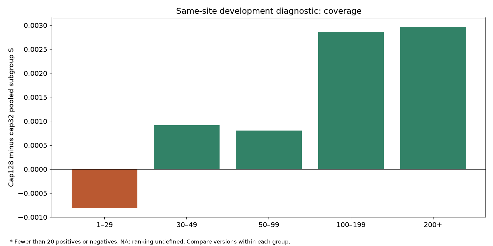
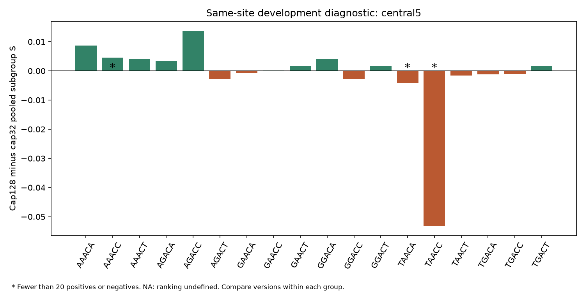
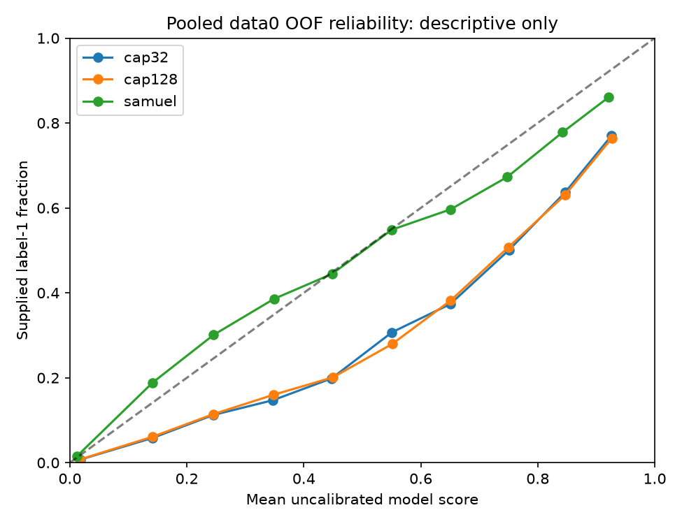

# Cap128 shortfalls and shared candidate comparison

Completed saved-data0 analysis only: no training, model inference, data1 access, cutoff search or calibration fitting. All 121,838 sites and 3,852 genes are retained. This is reused development evidence, not a new blind test.

## Full-data0 comparison

The primary score remains mean-fold S=(ROC AUC+trapezoidal PR AUC)/2; pooled subgroup results below do not replace it.

| Model | Mean-fold ROC AUC | Mean-fold PR AUC | Mean-fold S | Pooled precision at 0.5 | Recall at 0.5 | F1 at 0.5 |
|---|---:|---:|---:|---:|---:|---:|
| cap32 | 0.931123400 | 0.504160258 | 0.717641829 | 0.478953 | 0.615160 | 0.538578 |
| cap128 | 0.931828177 | 0.505601037 | 0.718714607 | 0.473929 | 0.614247 | 0.535041 |
| samuel | 0.921896746 | 0.498996251 | 0.710446499 | 0.627457 | 0.355616 | 0.453952 |

## Matched subgroup results

These are pooled OOF metrics on identical sites for each version. PR AUC depends on group prevalence. All five fold-level values, support warnings and paired changes are retained in the CSVs. Sparse or single-class groups are not removed; ranking is undefined for a one-class group.

| Group | Sites | Positive labels | Cap32 S | Cap128 S | Samuel S | Cap128 minus cap32 |
|---|---:|---:|---:|---:|---:|---:|
| coverage: 1–29 | 25104 | 1107 | 0.697938 | 0.697127 | 0.683538 | -0.000811 |
| coverage: 30–49 | 38830 | 1733 | 0.723553 | 0.724470 | 0.720626 | 0.000917 |
| coverage: 50–99 | 33371 | 1431 | 0.737629 | 0.738436 | 0.725635 | 0.000807 |
| coverage: 100–199 | 14314 | 743 | 0.751464 | 0.754326 | 0.738950 | 0.002862 |
| coverage: 200+ | 10219 | 461 | 0.692223 | 0.695188 | 0.667850 | 0.002964 |
| depth_target: 100+ | 24533 | 1204 | 0.727391 | 0.729896 | 0.710985 | 0.002505 |
| depth_target: 200+ | 10219 | 461 | 0.692223 | 0.695188 | 0.667850 | 0.002964 |
| unusual_signal: flagged | 1645 | 102 | 0.736653 | 0.741478 | 0.737427 | 0.004824 |
| unusual_signal: unflagged | 120193 | 5373 | 0.715509 | 0.716314 | 0.709318 | 0.000804 |
| member1: reviewed_unique_sites | 36 | 2 | 0.586152 | 0.564216 | 0.532843 | -0.021936 |

The first historical coverage bin is named 1–29, but all observed sites in it have 20–29 reads. The earlier read-depth report's approximately 0.732322 for the 100+ cohort is a mean-fold value; its corresponding pooled value is 0.727391, matching cap32 above. Do not compare that mean-fold score with these pooled subgroup scores.

## What changed at the fixed 0.5 cutoff?

0.5 is an unvalidated reporting cutoff; versions need not have comparable score calibration. A fixed/new error is a crossing of this cutoff, not verified chemical correction.

| Scope / control -> cap128 | Positive errors fixed | New positive errors | Negative errors fixed | New negative errors |
|---|---:|---:|---:|---:|
| all:all_data0 / cap32 | 49 | 54 | 147 | 216 |
| all:all_data0 / samuel | 1433 | 17 | 21 | 2598 |
| depth_target:200+ / cap32 | 2 | 2 | 2 | 5 |
| depth_target:200+ / samuel | 66 | 1 | 3 | 81 |

## Score reliability

| Model | Brier score | Equal-width 10-bin ECE | Mean score | Label prevalence |
|---|---:|---:|---:|---:|
| cap32 | 0.034952 | 0.037265 | 0.082202 | 0.044937 |
| cap128 | 0.034883 | 0.035654 | 0.080590 | 0.044937 |
| samuel | 0.029386 | 0.006305 | 0.040984 | 0.044937 |

These describe raw OOF score reliability under the supplied labels, not calibrated molecule-level probabilities or SG-NEx modification fractions. Brier score includes class imbalance; ECE depends on the declared ten bins. No calibration/threshold was fitted or selected, and no improved ranking can be claimed from a monotonic rescaling alone.

## EDA links and limitations

- Coverage/context groups follow the existing diagnostics. The primary investigated shortfall is >=200 reads; >=100 is a secondary comparison with the earlier depth cohort. All 288 exact 7-base contexts and all 18 central 5-base motifs are retained, including sparse groups, in subgroup_metrics.csv.
- Unusual flags reuse the previous label-free central5-conditioned 3-IQR fences fitted on the four non-assessment gene groups, with the same minimum 30-site fallback. No flags, labels or model scores are changed. Member 1 review entries are separate handoff candidates; repeated entries are counted once per site for metrics.
- Model-source/input signatures and hashes are checked; saved scores are rescored with the common evaluator. This corroborates saved evidence, not independent retraining of Samuel's or the neural pipelines. Their modelling/tuning budgets and loss weights differ.
- Many subgroup comparisons are exploratory, not independent biological experiments or significance tests. Fold means with fewer than five evaluable folds are labelled with that denominator, not a new headline score.
- Threshold/calibration fitting must use training-side data0 genes. A naive pooled-OOF threshold search after repeated development cannot be reported as an unbiased improvement; ordinary OOF predictions from other folds can still depend on a nominal assessment fold through those folds' training sets.
- These results do not select a new architecture, prove an outlier mechanism, evaluate data1 or produce a final all-data0 model/SG-NEx predictions. A candidate decision and next experiment rationale are recorded separately after review.







## Exact command

From the repository root, using the retained local inputs and saved runs:

```powershell
../advanced_model/.venv/Scripts/python.exe -B model_elgin/tools/analyse_read_cap_shortfalls.py
```
