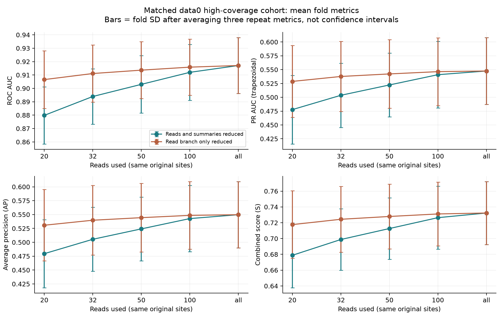
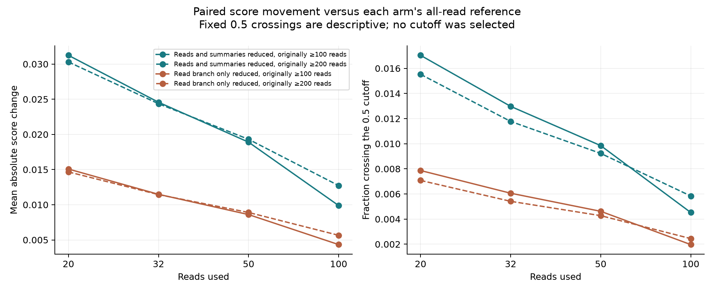
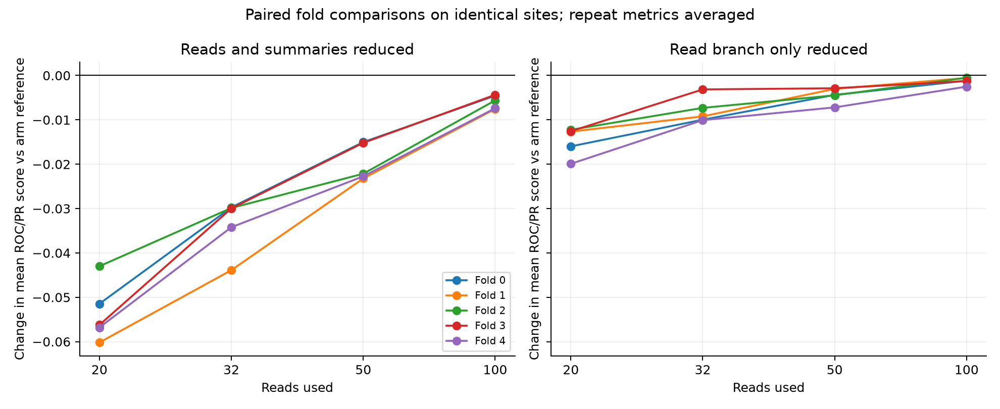

# Read-depth stability: actual results, 20 October 2026

**Recommendation: keep all-read inference for the current neural pipeline.**
Reducing the observations did not resolve its high-coverage weakness. The
primary score decreased at every sampled depth, in every held-out fold and
repeat, on the same original sites. This is a completed robustness diagnostic;
no model was trained, selected or calibrated by it.

## Question and connection to EDA

Member 1 recommended read-subsampling checks because coverage associations
changed between supplied datasets. Earlier saved-score diagnostics showed
weaker performance at >=200 reads, but compared different site populations.
We therefore held the sites fixed and changed only the input observations.
Source inspection identified a possible mechanism: training used a maximum
32-read attention bag but retained all-read summaries, whereas assessment used
all reads in both branches. The 32-read level was specified before results.

## Completed design

- Data0 only: **24,533 sites, 1,204 positive labels, 1,002 genes**, each with
  originally 100–991 reads. Every site uses its matching held-out-gene refit
  model from the completed 19 October original-feature control.
- Three deterministic nested sampling draws, seeds 2026/2027/2028, without
  replacement. All depths use the same cohort and labels. Every valid site
  remains; no outlier deletion or relabelling.
- Primary: reduce read bag and recompute all 63 summaries from those same reads.
  Secondary: reduce only the read branch, retaining original full summaries;
  this is a mechanism check, not a fully low-depth sample.
- **130 complete conditions, 637,858 prediction rows**. Two all-read controls
  are stored once per site, not repeated to inflate evidence.

## Measured scores on this matched cohort

| Reads | Primary ROC AUC | Primary trapezoidal PR AUC | Primary S | Secondary read-branch-only S |
|---|---:|---:|---:|---:|
| 20 | 0.879844 | 0.477733 | 0.678788 | 0.717650 |
| 32 | 0.893944 | 0.503624 | 0.698784 | 0.724380 |
| 50 | 0.903009 | 0.522298 | 0.712653 | 0.727932 |
| 100 | 0.911989 | 0.540859 | 0.726424 | 0.731116 |
| All original reads | 0.917089 | 0.547554 | 0.732322 | 0.732322 |

S=(ROC AUC + trapezoidal PR AUC)/2. Each depth first averages three draw metrics
within each fold, then averages the five folds equally. AP, fold SD and draw
variation are retained in [aggregate metrics](depth_metrics.csv). Draws are
not independent biological replicates and fold SD is not a confidence interval.

**These are not new full-data0 CV scores.** The original 121,838-site control
score remains **0.717641829**; its population differs from this restricted
high-coverage cohort. This experiment does not establish an improvement over
that model or a new comparison against Samuel.

## What we learned

- Primary S falls from **0.732322 with all reads** to **0.678788 with 20**:
  delta **-0.053534**. At 32/50/100 the corresponding deltas are
  **-0.033538 / -0.019669 / -0.005898**. All 60 paired primary fold/draw/depth
  differences are negative; they are repeated observations, not 60 independent
  biological experiments or a significance test.
- The originally >=200-read subset (10,219 sites) shows the same direction:
  primary S **0.706732** with all reads versus **0.629879** with 20. This
  supports retaining observations in the current pipeline; it does not identify
  the biological or technical reason those sites are harder.
- Keeping full summaries mitigates the loss, but secondary mean S still remains
  below its all-read control at each sampled depth. Summary estimation appears
  relevant; nonlinear interactions prevent assigning the exact loss to one branch.
- At 20 reads, primary predictions cross the existing 0.5 cutoff in **1.70%**
  of all site/draw observations. Among positive-labelled observations this is
  **12.51%**, versus **1.15%** among negatives. These are stability diagnostics;
  the 0.5 cutoff was not selected or validated here.
- Original-cache scores reproduce saved OOF within **1.19e-7**. Recomputing
  summaries from float32 cached reads, instead of the original float64-derived
  summaries, changes scores by at most **1.94e-6**, with **zero** cutoff flips.
  Separate arm-correct controls prevent attributing that rounding to depth.

## Practical conclusion and limits

Continue using all available reads for this candidate. Do not adopt a 32-read
prediction cap simply because training sampled 32. Next inspect remaining
high-coverage errors within sequence context and review unusual valid signal
distributions before choosing another intervention. No additional training
was launched as a consequence of this diagnostic.

The experiment computationally removes observations from originally well-covered
sites. It does not recreate independent low-depth sequencing, justify discarding
naturally low-coverage sites, prove modification states per molecule, or estimate
modification fractions. Predicted cell-line comparisons still need real SG-NEx
scores, replicate/coverage sensitivity and reference checks. Data1, data2 and
SG-NEx inputs were not used. The model, gene folds, preprocessing and cutoff
are unchanged.

## Computation, checks and reproduction

The full inference CLI completed in **442.019 seconds (7 min 22 sec)** on four
CPU threads. Its measured scope after imports was **427.880 wall seconds**,
**1,604.391 process CPU seconds**, sampled peak process-tree RSS **783.1 MiB**.
All completed conditions together account for **400.772 wall seconds** and
**1,551.063 CPU seconds**; this narrower sum excludes preflight/model loading.
These are inference-diagnostic costs, not training costs or a hardware-matched
comparison with another person's laptop. Final report/plot generation was
measured separately in the retained analysis manifest.

Sixteen small software checks passed, then a 500-site/130-condition trial and
report check passed before the full run. Independent arithmetic from condition
receipts exactly matched the reporter's mean metrics (tolerance1e-12). The
original model/cache/source/fold hashes and complete output fingerprints were
checked; three plots were visually reviewed. Initial small-check issues were
an inconsistent synthetic gene ID and an overly long Windows atomic-write
filename; both were fixed before real full-cohort execution.

From the repository root, in the original recorded environment:

```text
python -B -u model_elgin/tools/read_depth_stability.py --output-dir model_elgin/outputs/read_depth_stability_v1 --depths 20,32,50,100 --seeds 2026,2027,2028 --perturbation both,bag-only --threads 4 --batch-size 64 --max-padded-reads 65536
python -B model_elgin/tools/report_read_depth_stability.py --run-dir model_elgin/outputs/read_depth_stability_v1/full
```

On the executing laptop `python` was `../advanced_model/.venv/Scripts/python.exe`.
Exact stdout, commands, timings, condition completion/attempt logs and full
predictions/tables remain under local ignored
`model_elgin/outputs/read_depth_stability_v1/`. Rerun the same inference command
to reuse complete matching conditions; interrupted attempts are preserved.
Changed settings/source need a new experiment directory. A fresh clone must
first reproduce the required full control CV/cache; those local checkpoints
are not silently substituted with the historical all-data0 model.

This folder shares only a compact summary, aggregate metrics, controls and
figures. Full site-level CSVs remain local. See the
[investigation plan and commands](../READ_DEPTH_STABILITY.md).






