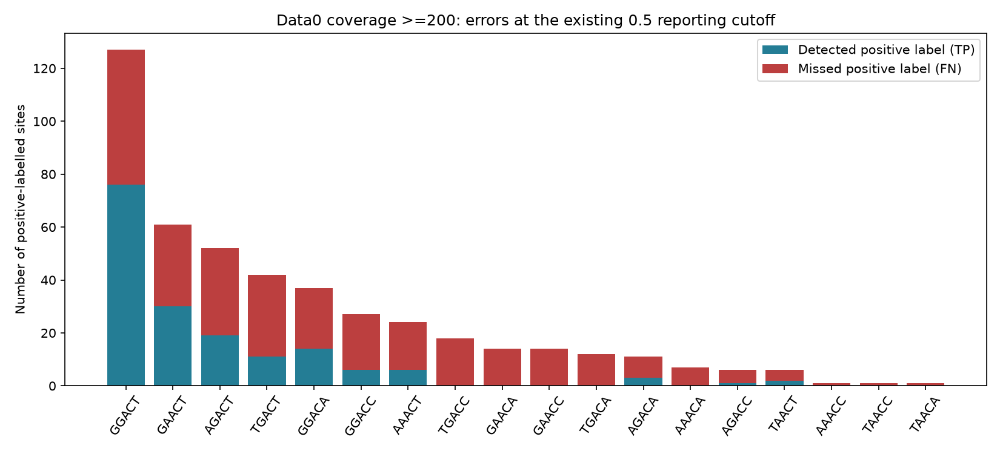
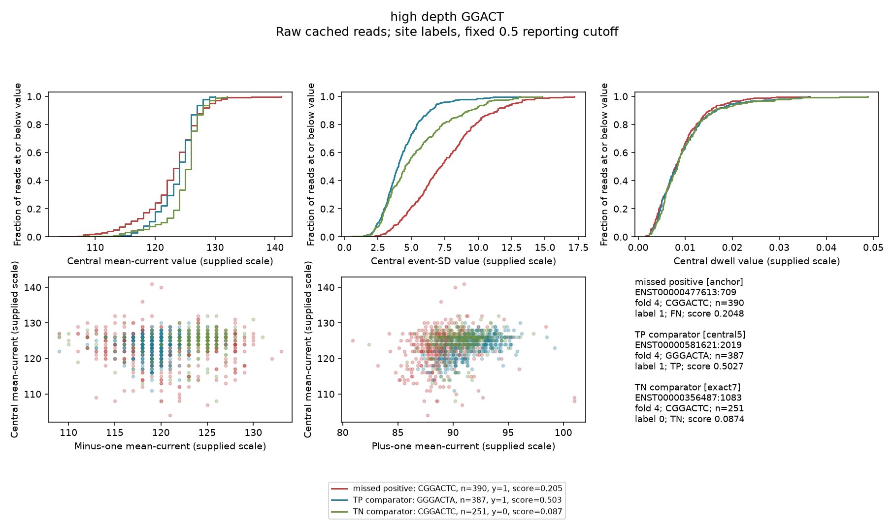
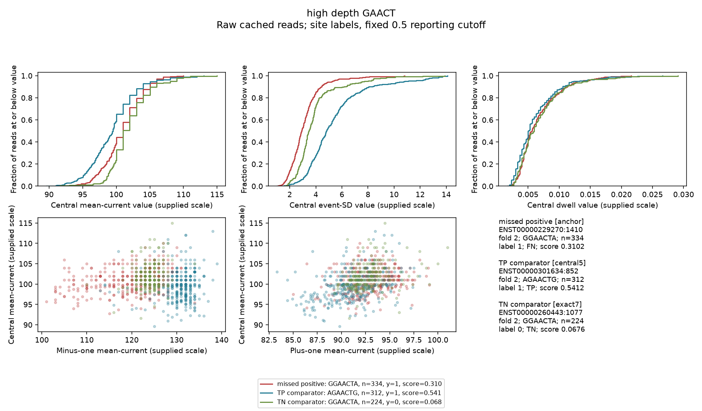
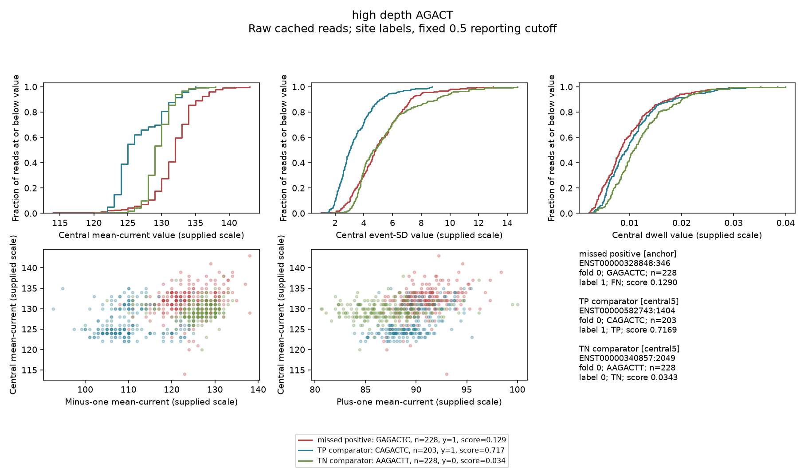
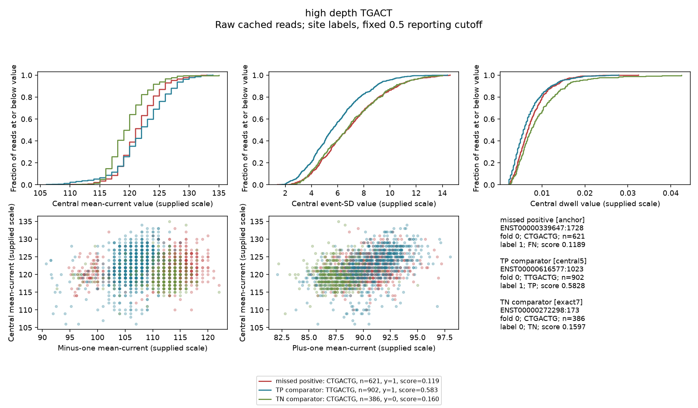
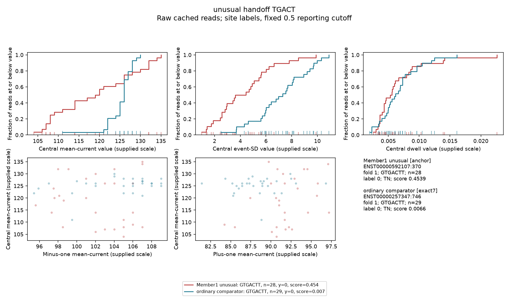
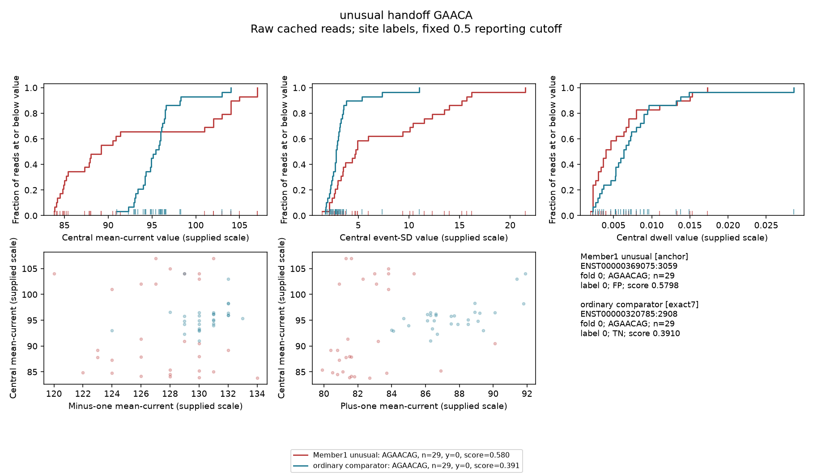
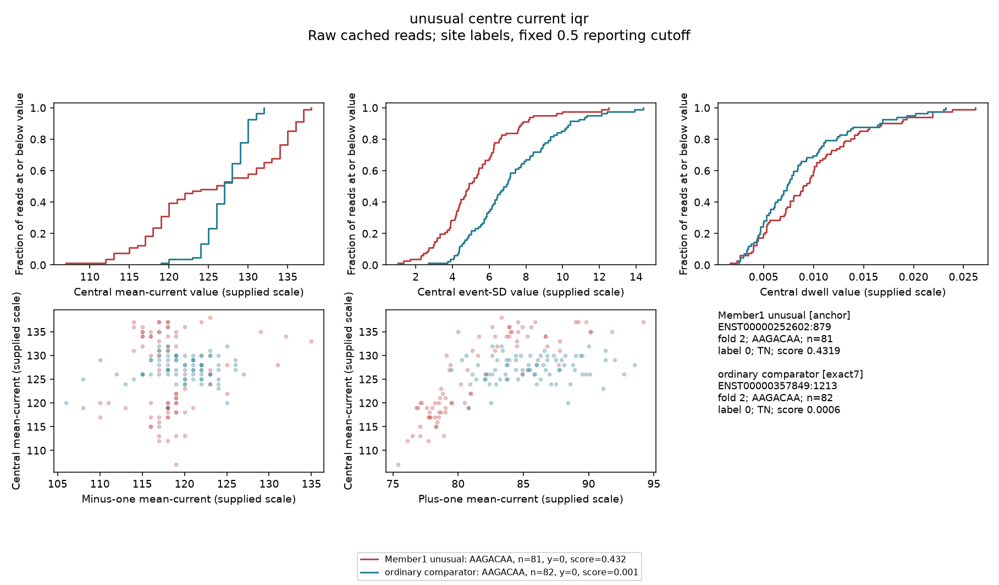
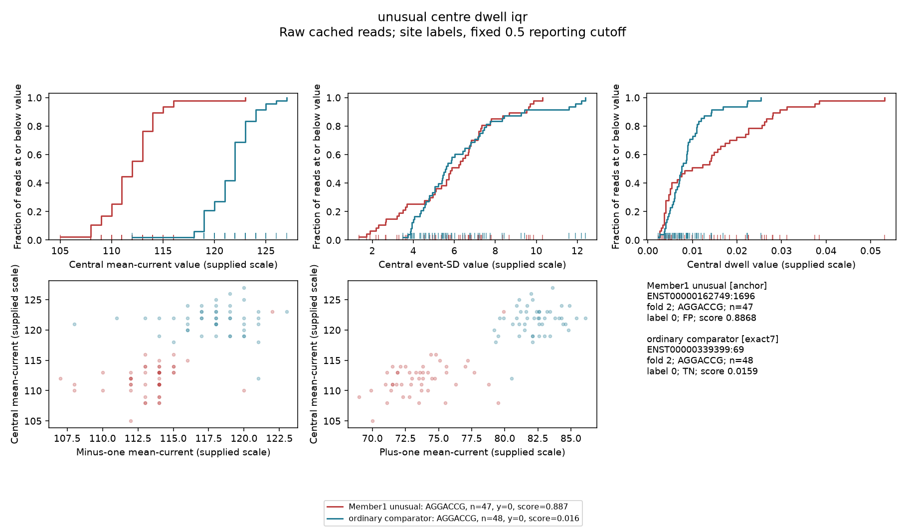

# Data0 signal-case review: actual results

**Completed descriptive analysis; no training, inference, data1 signal/label files or cutoff selection.**

The verified original-feature OOF scores cover 121,838 sites and 5,475 positive site labels. The >=200-read group has 10,219 sites, 461 positives, 168 TP and 293 FN at the existing 0.5 reporting cutoff (recall 0.364). The cutoff is not a validated biological rule. The full five-fold model score remains **S=0.717642**; these case plots do not establish a new improvement.

## Context and coverage matching

Among all 293 high-depth FNs, 182 have an eligible TP comparator; 38 exact7, 144 central5 fallback, 111 unmatched. 81 distinct TP comparators are reused with replacement. Matches share the saved model/fold, use different genes and >=200 reads, and differ by at most 2x coverage. Exact7 is preferred before coverage proximity; central5 fallback leaves flank differences.

| Central5 | Sites | Positive labels | TP | FN | Recall at 0.5 |
|---|---:|---:|---:|---:|---:|
| GGACT | 500 | 127 | 76 | 51 | 0.598 |
| GAACT | 530 | 61 | 30 | 31 | 0.492 |
| AGACT | 525 | 52 | 19 | 33 | 0.365 |
| TGACT | 597 | 42 | 11 | 31 | 0.262 |
| GGACA | 583 | 37 | 14 | 23 | 0.378 |
| GGACC | 577 | 27 | 6 | 21 | 0.222 |
| AAACT | 768 | 24 | 6 | 18 | 0.250 |
| TGACC | 643 | 18 | 0 | 18 | 0.000 |
| GAACA | 700 | 14 | 0 | 14 | 0.000 |
| GAACC | 475 | 14 | 0 | 14 | 0.000 |
| TGACA | 704 | 12 | 0 | 12 | 0.000 |
| AGACA | 604 | 11 | 3 | 8 | 0.273 |
| AAACA | 839 | 7 | 0 | 7 | 0.000 |
| AGACC | 629 | 6 | 1 | 5 | 0.167 |
| TAACT | 358 | 6 | 2 | 4 | 0.333 |
| AAACC | 539 | 1 | 0 | 1 | 0.000 |
| TAACA | 384 | 1 | 0 | 1 | 0.000 |
| TAACC | 264 | 1 | 0 | 1 | 0.000 |



Paired raw summary differences below are FN minus TP, with one pair per matched FN. They describe selected errors, not a new predictor, causal effect or significance test. Reads, reused comparators, genes and folds are not independent biological replicates.

| Scope | Feature | Pairs | Median difference | Pair-difference Q25 / Q75 | FN greater fraction |
|---|---|---:|---:|---:|---:|
| all_matches | centre_dwell | 182 | 0.0004975 | -0.00041 / 0.00116 | 0.654 |
| all_matches | centre_event_sd | 182 | 0.55 | -0.105 / 1.56 | 0.703 |
| all_matches | centre_current | 182 | 3 | 1 / 5 | 0.780 |
| all_matches | centre_current_iqr | 182 | -1 | -2 / 0.287497 | 0.264 |
| all_matches | centre_dwell_iqr | 182 | -2.49998e-05 | -0.000764375 / 0.0007575 | 0.489 |
| exact7_only | centre_dwell | 38 | 0.00083 | 0.000315 / 0.00139 | 0.789 |
| exact7_only | centre_event_sd | 38 | 0.35 | -0.3525 / 1.41625 | 0.684 |
| exact7_only | centre_current | 38 | 3.5 | 2 / 5 | 0.816 |
| exact7_only | centre_current_iqr | 38 | -0.125 | -1.98125 / 1.8125 | 0.421 |
| exact7_only | centre_dwell_iqr | 38 | 0.0002275 | -0.00040375 / 0.00086875 | 0.553 |

## Fixed representative cases

One FN nearest its own motif FN median score was selected for each of the four motifs with most high-depth positive labels. TP and TN matches follow the prespecified rule. Examples are illustrative and were not selected for visual separation. Full local case-selection CSV records keys, folds, context, coverage and classification. All reads are plotted; lower-depth panels include rugs.









## Member 1 unusual valid sites

All 36 received data0 review entries were joined to raw cache/labels/OOF scores; 36 distinct sites. Maximum absolute cached-IQR minus original Member1-IQR difference is 4.5776367e-06 on supplied feature scales (float32 cache versus source calculations). Metadata, labels and coverage agree. No entry was discarded or relabelled.

The two explicitly named handoff cases (28 and 29 reads) are reviewed separately from the >=200 cohort. Additional panels use the greatest-coverage received data0 review example for each named IQR feature. Ordinary comparators have the same site label and fold, another gene, matching sequence/coverage, no prior median-fence flag, and relevant IQR at or below their candidate pool median. They were not required to be classified correctly. A broad spread does not prove a mixture, another RNA modification or faulty reads; molecular labels and alignments are unavailable.









## Missing support

All prespecified illustrative matches were available.

## What the measured patterns suggest

In the 38 exact-7mer matched pairs, FN central-current medians exceed TP medians in 81.6% of pairs; median difference 3.5 on the supplied scale. Central-current IQR is greater in only 42.1%, with median difference -0.125. The missed positives are therefore not uniformly broader-spread cases. The 38 exact-context pairs are a selected, limited-support subset and do not explain all high-depth errors.

All four illustrative high-depth TP matches required central5 fallback; their flank bases differ from their anchors. Their plots cannot isolate a pure signal effect while holding the complete neural sequence input constant. The all-FN exact7 summary above provides the stronger context-controlled descriptive evidence.


## Interpretation and next modelling decision

This completes the bounded error inspection that follows Member1 EDA. Sequence, coverage and valid within-site spread are represented explicitly in the evidence. Descriptive error-conditioned contrasts cannot establish the cause of a missed label. Do not delete sites, add a hand-coded motif rule, force a better score, or interpret site scores as molecular modification fractions.

Retain all-read inference. Any next trained candidate should change one mechanism and use the same full data0 gene-fold comparison. The required simple baseline and published m6Anet benchmark, final nomination/refit, data0-only cutoff validation, frozen exposed-data1 evaluation and real SG-NEx predictions/analysis remain pending; this investigation does not complete those tasks.

Recommended next neural hypothesis: increase the training read-branch cap from 32 to 128, keeping original features, loss, splits, stopping and all-read inference unchanged. This lets the branch learn from larger samples of each site distribution. It is motivated by the saved training/inference mismatch and completed depth study; the case plots do not prove this mechanism caused the errors. No gain is promised and no such candidate has been trained. Compare by the full-data0 shared S, retaining results even if worse. Threshold validation is a separate data0-inner-gene task and can change recall/precision without improving ranking.

## Reproduction, resources and limits

From the repository root, with the original local data0 cache, canonical labels/shared folds and completed control CV bundles:

```powershell
../advanced_model/.venv/Scripts/python.exe -B -u model_elgin/tools/review_signal_cases.py
```

Dependencies use the retained advanced-model environment (NumPy, pandas, PyTorch, scikit-learn, psutil and matplotlib); their actual versions and input/output hashes are in run_manifest.json. Full case/pair/raw-summary CSVs stay in ignored outputs/error_case_review_v1. A deterministic interrupted run can be rerun; invocation records distinguish failures and completion.

Measured analysis wall 33.021 s; process CPU 31.953 s; sampled peak process-tree RSS 504.0 MiB (0.2 s sampling). Timing includes input validation, statistics and figure/table generation after imports; excludes this final report/manifest write. No GPU/cloud training occurred.

The existing architecture and prior features were selected during development. OOF errors are useful for generating hypotheses, but further changes evaluated on these same groups remain development comparisons. Units are retained as supplied scales because physical-unit provenance has not been verified. Gene/sequence/coverage matching does not remove all confounding. The received multi-dataset Member1 review table was read and filtered to data0 entries; no data1 signal/label file or data1 evaluation was used.
