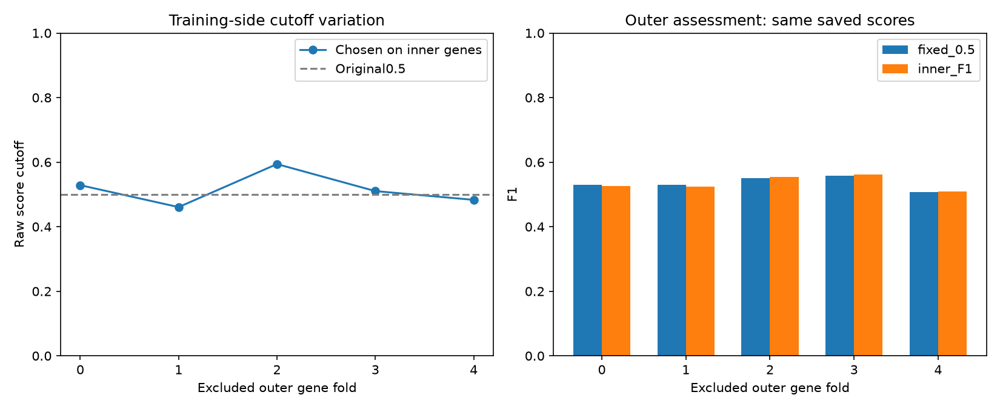
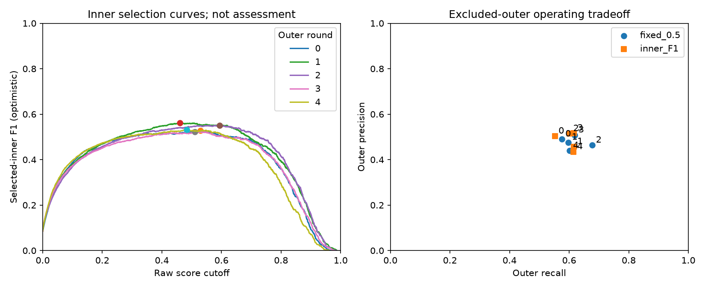

# Cap128 training-side calling-threshold study

Completed threshold-only data0 development study. Saved neural weights and continuous scores are unchanged; no neural training, probability calibration or data1 evaluation occurred.

For each excluded outer fold f, the saved three-group inner best model predicted only inner group(f+1)%5. Its maximum-F1 cutoff, with higher-cutoff exact ties, was applied to that round's existing four-group refit OOF scores. Inner F1 is selected and optimistic, not evaluation performance.

## Cutoffs selected without their outer assessment genes

| Outer fold | Inner group | Inner sites | Inner positives | Chosen cutoff | Selected inner F1 | Outer F1 at0.5 | Outer F1 at chosen cutoff |
|---|---:|---:|---:|---:|---:|---:|---:|
| 0 | 1 | 24371 | 1097 | 0.528605998 | 0.528318 | 0.529337 | 0.526454 |
| 1 | 2 | 24387 | 1105 | 0.460746258 | 0.561107 | 0.529721 | 0.524272 |
| 2 | 3 | 24378 | 1100 | 0.593996286 | 0.550222 | 0.550331 | 0.554398 |
| 3 | 4 | 24344 | 1083 | 0.510309458 | 0.522965 | 0.557968 | 0.561360 |
| 4 | 0 | 24358 | 1090 | 0.483205169 | 0.532609 | 0.507405 | 0.509174 |

## Excluded-outer assessment

Pooled rows sum all outer confusion counts. Learned-policy pooled decisions use five different training-side cutoffs. Fold means are unweighted; sample SD is descriptive, not a confidence interval.

| Summary / policy | Precision | Recall | F1 | Specificity | Accuracy |
|---|---:|---:|---:|---:|---:|
| pooled_outer / fixed_0.5 | 0.473929 | 0.614247 | 0.535041 | 0.967919 | 0.952026 |
| pooled_outer / inner_F1 | 0.482096 | 0.600000 | 0.534624 | 0.969672 | 0.953061 |
| mean_fold / fixed_0.5 | 0.475251 | 0.614068 | 0.534952 | 0.967919 | 0.952026 |
| sample_sd_fold / fixed_0.5 | 0.026208 | 0.038908 | 0.019900 | 0.004250 | 0.003130 |
| mean_fold / inner_F1 | 0.484796 | 0.599966 | 0.535132 | 0.969672 | 0.953059 |
| sample_sd_fold / inner_F1 | 0.036998 | 0.027278 | 0.021944 | 0.005209 | 0.004274 |

The predeclared median of five inner cutoffs is **0.510309457779**, a proposal for the later all-data0 deployment model. It was not evaluated as a single global cutoff on these outer rows, is not guaranteed F1-optimal, and its score-scale transfer to a future all-data0 model is untested.

ROC AUC, trapezoidal PR AUC, AP and S are unchanged. Mean-fold cap128 ROC/PR/S remain0.9318281774/0.5056010366/0.7187146070. Threshold adjustment must not be presented as improved ranking.

## Limits and retained evidence

- Choosing epoch and cutoff on one inner group is model selection. Each outer assessment group stays outside both choices. Architecture/model selection has already used these development folds; this is not a new blind or unbiased final test.
- The selected cutoff comes from a three-group model and is applied to a fresh four-group refit. The outer results measure that transfer; the final median rule is a separate engineering aggregation.
- The objective is site-label F1. It does not encode a verified biological false-discovery rate, calibrated probability, molecule fraction or optimum for every SG-NEx cell line. Retain continuous scores and threshold sensitivity for Task2.
- No cutoff is fitted from other rounds' ordinary OOF scores. Full inner predictions, unique-score curves, matching checkpoint receipts and per-round selected results stay local and permit checked resume. No assessment site is dropped or relabelled.
- This invocation's measured analysis work: wall27.480s, process CPU71.031s, sampled process RSS peak951.086MiB. Scope: After saved-CV/source/version preflight: cache validation/loading, all required inner inference or receipt reuse, threshold/outer analysis and figures. Imports, initial preflight and final report/manifest writes excluded. Reused rounds are disclosed in the manifest; prior invocations are not included in this timer.





## Exact command

From the repository root:

```powershell
../advanced_model/.venv/Scripts/python.exe -B -u model_elgin/tools/validate_calling_threshold.py
```
