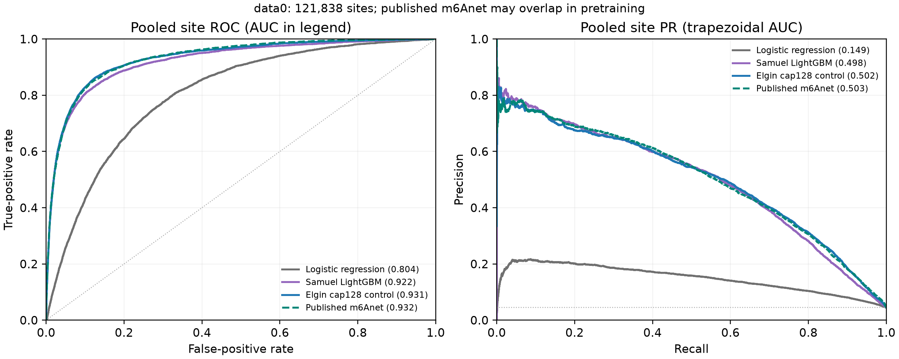
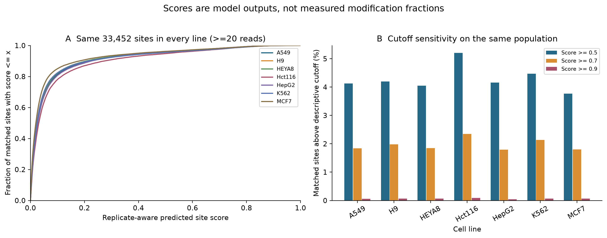
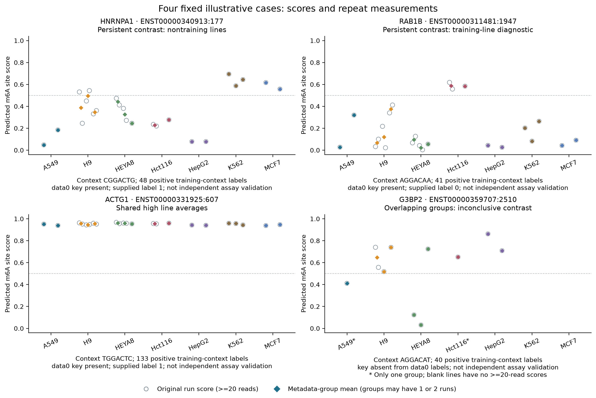

# First scientific draft — 25 October 2026

**For team review. Not final, submitted, or page-layout verified.** The intended
main body below must be typeset in Arial 11 within five pages; captions/tables
use Arial 9–11. References and editorial notes follow separately. Figure slots
link existing checked outputs. Public deployment, all 36 case control combinations,
four literal-site click/reload routes and an evidence download are checked.
This assistant-authored draft is not an individual reflection or a
statement of team-member contributions.

<!-- MAIN_BODY_START -->

# Sequence-aware m6A site prediction and cautious exploration across SG-NEx cell lines

## Introduction

N6-methyladenosine (m6A) is an RNA modification that can be investigated using
nanopore direct-RNA sequencing. Electrical-event measurements depend on local
sequence as well as modification state, complicating prediction. We developed
a site-supervised model and applied one frozen pipeline to SG-NEx data [1,2].
Our aim was reproducible candidate prioritisation with transparent limitations,
rather than interpreting model scores as measured modification fractions.

## Problem statement

Each candidate site contains a seven-base context and a variable-sized bag of
reads, each represented by nine measurements: dwell time, event standard
deviation (SD) and mean current at three neighbouring events. Labels describe sites,
not individual reads. The tasks were to assess site-label prediction and compare
predicted patterns across cell lines without confusing missing coverage,
technical differences or training exposure with biological differences.

## Methods

**Data and exploratory rationale.** Training data0 comprised 121,838 sites,
5,475 positives and 3,852 genes. Data1 contained 90,810 sites and 6,593 positives;
data2 contained 1,323 rows with fractional labels and repeated sequence templates.
Only data0 was used for the selected pipeline's fitting and tuning. Data1 had
already informed earlier development; data2 was not converted into binary labels.

Exploration showed that pooled central current increased from 114 to 118 between
data0 label groups, although positives had lower current within 11/15 adequately
supported motifs. This motivated sequence conditioning and distribution summaries.
Data0/data1 shared 67,320 literal site keys, including 3,872 label disagreements,
supporting cautious transfer interpretation. Valid unusual sites were retained.

**Evaluation and model.** Early screening included logistic regression, support
vector machines, random forest, XGBoost and LightGBM, using 18 read-mean/SD
features and shared gene folds. Tuning budgets and verification depth differed;
their historical data1-exposed results are not merged into the later comparison.

The later assessment retained the exact five data0 gene folds. For outer fold
*f*, inner fold *(f+1) mod 5* selected training duration; fresh weights and
training-only normalisation then fitted all four non-assessment folds before
scoring *f*. Every gene's sites remained together. Ranking used area under the
receiver operating characteristic (ROC) and precision–recall (PR) curves (AUC).
Primary score S was the
unweighted mean of five (ROC AUC + trapezoidal PR AUC)/2 values. Average precision
and pooled out-of-fold areas were separate summaries. Repeated development on
these folds limits their interpretation as generalisation estimates.

The selected neural pipeline combined seven-base embeddings, width-48 read
encoding, gated attention/mean/SD pooling and 63 all-read distribution summaries.
Training sampled at most 128 reads per site, with positive loss weight three;
prediction used all valid reads. No probability calibrator was fitted. A fresh
18-epoch model was fitted on all data0, using the median inner-selected duration,
and frozen before the reported data1 diagnostic and SG-NEx application.

**SG-NEx comparison.** We analysed 23 processed runs spanning seven cell lines
and 17 metadata groups. Sites required at least 20 reads for prediction. Matching
retained literal transcript positions, explicit per-run aliases and the model's
uppercase/U-to-T encoding. Primary comparisons required consistent contexts,
annotated human keys and at least two eligible metadata groups per line. Eligible
runs were averaged within group, then groups received equal weight. Pairwise and
all-seven common populations were separate. Read thresholds 20/50/100 and score
cutoffs 0.5/0.7/0.9 were descriptive sensitivities.

## Results (1): model evaluation

All benchmark rows covered the same 121,838 assessment sites. Logistic regression
was a fresh fixed-recipe baseline; LightGBM and the neural model used gene-held-out
development fits. Published m6Anet used pretrained HCT116_RNA002 weights: fold IDs
stratified its predictions, rather than defining retraining partitions [1].

| Pipeline | Mean ROC AUC | Mean PR AUC | Mean S |
|---|---:|---:|---:|
| Logistic regression | 0.804056 | 0.149129 | 0.476592 |
| LightGBM | 0.921897 | 0.498996 | 0.710446 |
| Selected cap128 neural model | 0.931828 | 0.505601 | 0.718715 |
| Published m6Anet reference | 0.932176 | 0.503257 | 0.717717 |

The neural–m6Anet S difference was approximately 0.000998; m6Anet had higher
ROC AUC. Unresolved pretraining overlap prevents an independent-superiority
claim. Increasing the neural training read cap from 32 to 128 increased S from
0.717642 to 0.718715; an added relative-context branch decreased it to 0.708885.
Removing positive weighting gave 0.718381 and reduced recall at 0.5. These small
development differences do not establish statistical significance.

A separate external neural trial genuinely achieved higher S, 0.726644, improving
all five folds. Promotion remained inconclusive: fixed-cutoff/subgroup outcomes
were mixed, evidence used one seed and different computational conditions, and
its final general prediction interface/artifact was incomplete. At 200+ reads,
recall was 151/461 versus 168/461 for cap128 despite better ranking. Retaining the
integrated pipeline was a conservative tradeoff, not proof it was globally best.

Frozen data1 ROC/PR/S were 0.827381/0.382350/0.604866, versus LightGBM
0.821764/0.382879/0.602322. Neural recall/F1 were higher at 0.5, whereas LightGBM
had higher precision/specificity. This exposed transfer diagnostic did not
reselect the model. Final all-data0 predictions were fitted-data outputs, not
validation; no binary data2 AUC was claimed.

**Figure 1.** Pooled score curves are supplementary to the mean-fold table;
their areas need not coincide. The PR reference reflects 4.49% positive labels.
Published m6Anet is a pretrained reference with possible HCT116 overlap, not
independent gene-held-out retraining. No significance or calibration claim follows.

## Results (2): application to SG-NEx data

The unchanged model produced 2,983,948 scored run-site observations using
232,253,678 reads. Context auditing compared 8,780,071 source observations,
including low-read records, at 451,352 scoreable keys: zero context conflicts
or exclusions occurred. Another 19,890,009 observations outside that union were
counted but not cross-run context-compared. Agreement does not verify historical
reference identity or event offsets.

Requiring two groups per line yielded 33,452 all-seven common sites at 20 reads,
11,560 at 50 and 5,058 at 100. On the same 33,452-site panel, mean scores ranged
from 0.0705 to 0.0946; 3.76–5.20% met 0.5 and only 15–31 sites per line met 0.9.
Hct116 had the highest mean but was also the training cell line. These fractions
describe predictions, not modification prevalence.

Median run-pair Spearman agreement at 20 reads was 0.7904 across six same-group
pairs, 0.7934 across 28 other-group same-line pairs and 0.7815 across 219
cross-line pairs. Overlapping ranges and shared sequence structure limit a
cell-line-separation interpretation. Each correlation uses its own matched sites.
Across all 21 line pairs, the exploratory screen required absolute mean-score
difference ≥0.2, separated group ranges and coverage ratio ≤2. For example,
2,331/120,195 Hct116–HepG2 shared sites passed; no significance/false-discovery control was
applied. All outcomes and valid extremes were retained.

**Figure 2.** Scores and cutoff fractions use matched, context-qualified
all-seven populations with equal group weights. Depth thresholds select different
site populations; changes are not a controlled within-site coverage experiment.
Cutoffs are descriptive. Hct116's training-domain affinity and technical factors
cannot be separated from biology.

Fixed rules selected four illustrative cases from 1,004 persistent pair-site
contrasts representing 545 keys, 41 shared-high sites and 6,098 inconclusive
pair-site candidates. HNRNPA1 ENST00000340913:177 showed K562/HepG2 means
0.642/0.078 with separated groups; RAB1B ENST00000311481:1947 showed
Hct116/HepG2 means 0.586/0.035. ACTG1 ENST00000331925:607 retained seven-line
means 0.942–0.959. G3BP2 ENST00000359707:2510 had overlapping HEYA8/HepG2 group
ranges, and its contrast lacked two-group eligibility at 50/100 reads.

Three selected keys occurred in data0, with labels 1/0/1; they are not
independent validation. Published HNRNPA1 and ACTG1 assays were not mapped to our
selected coordinates [3,4]. Stable threshold results can reuse identical
observations. These tail-selected cases prioritise follow-up rather than confirm
differential m6A or altered gene function.

**Figure 3.** Original run scores and metadata-group summaries retain all four
case roles, training exposure and context support. Across 92 run records,
80 were scored and 12 below-20-read records remained unscored. Missing or
depth-ineligible is not zero; one-group scores are diagnostic. Group ranges
are not confidence intervals, and these selected extremes are not representative.

## Discussion

The pipeline provides useful site-label ranking and an inspectable SG-NEx
resource, with substantial limits. Among 33,452 common sites, 22,219 had fewer
than 20 positive training labels for their seven-base context, including 4,290
with none; all remained with warnings. Reused development folds, exposed data1,
uncertain pretrained overlap and one training seed restrict generalisation
claims. Basecaller/platform/date differences are confounded with cell line;
metadata groups are not verified independent laboratory preparations. Nested
depth sensitivities and high score agreement cannot resolve those explanations.
Independent compatible assays and verified reference/offset mappings are needed
before chemical, stoichiometric or causal interpretation.

## Code Availability

Code, the frozen model, example and reproduction instructions are available at
[LIFO_m6A_project](https://github.com/elgintan/LIFO_m6A_project). Hosted explorer:
[SG-NEx m6A Explorer](https://lifo-sgnex-m6a-explorer.wittylemon1025.chatgpt.site).
The hosted explorer retains all 23 runs and literal case links. Hosted case
controls, click/reload navigation and an original-score CSV download passed;
anonymous file checks preserved the original data. Native AWS example parity passed;
this establishes software portability, not unseen accuracy. Actual new-test
input/submission remains separate and unclaimed.

## Use of AI methods

Prompts below are summaries; exact chat evidence is retained.

| AI tool used | Prompt and output | How output was used |
|---|---|---|
| Codex, main project chat | Continue the fixed pipeline; implement/check context QC, comparisons and explorer. | Analysis/UI code, audits, figures and documentation, with saved receipts and independent checks. |
| Codex, main project chat | Explain findings and prepare an evidence-based report. | Evidence map and this draft for team verification; other members' AI use awaits confirmation. |

Two actual project-level corrections were documented. Audit code assumed `fold` and labels
existed in the fold CSV; KeyError and inspection revealed `fold_id` without
labels. The corrected join passed exact-coverage checks. The assistant also
prematurely recommended the higher-S external trial as a clear winner; the user
identified its inconclusive promotion review. Rechecking retained its genuine
ranking gain while restoring the documented conservative deployment decision.

<!-- MAIN_BODY_END -->

## References — outside the main-body word count

1. Hendra C, Pratanwanich PN, Wan YK, et al. Detection of m6A from direct RNA
   sequencing using a multiple instance learning framework. *Nature Methods*
   19, 1590–1598 (2022). [DOI](https://doi.org/10.1038/s41592-022-01666-1).
2. Chen Y, et al. A systematic benchmark of Nanopore long-read RNA sequencing
   for transcript-level analysis in human cell lines. *Nature Methods* 22,
   801–812 (2025). [DOI](https://doi.org/10.1038/s41592-025-02623-4).
3. Sheehan et al. In situ visualization of m6A sites in cellular mRNAs.
   *Nucleic Acids Research* 51, e101 (2023). [DOI](https://doi.org/10.1093/nar/gkad787).
4. Mirza et al. SCARPET: site-specific quantification of methylated and
   nonmethylated adenosines reveals m6A stoichiometry. *RNA* 30, 308–324 (2024).
   [DOI](https://doi.org/10.1261/rna.079776.123).

## Evidence and editorial notes — not report body

- This is a first scientific draft. No five-page, Arial-font or final PDF
  rendering check has been performed. The title is working text, not an
  assertion of team agreement. Remove these planning notes from submission.
- Original requirements, source links and optional fourth figure are mapped in
  [REPORT_EVIDENCE_MAP_2026_10_25.md](REPORT_EVIDENCE_MAP_2026_10_25.md).
  Essential reasoning must stay in the graded five pages; the appendix is ungraded.
- **Initial five candidates:** names, 18-feature protocol and unequal tuning/
  verification depth are from the preserved [early comparison](INITIAL_MODEL_SCREENING_CONTEXT.md).
  Its older data1 numbers are deliberately excluded from the later benchmark
  table. The later LightGBM row describes the delivered revised pipeline.
- **EDA and folds:** [EDA handover](../eda/received/MEMBER1_CONTEXT_2026-10-13.md),
  [shared contract](../model_evaluation/SHARED_RULES.md),
  [composition audit](../eda/split_review/README.md). “Adequately supported” in
  the EDA statement means at least 20 sites in each label within a motif, not
  a filter on the final model population.
- **Model table and Figure 1:** [benchmark CSV](../model_evaluation/benchmark_results_2026_10_22/comparison.csv)
  and [protocol](../model_evaluation/benchmark_results_2026_10_22/README.md).
  Keep the pretrained-reference distinction visible in both caption and table.
- **Selection, negative findings, final fit/data1:** [fixed decision](../model_elgin/FINAL_MODEL_SELECTION.md),
  [actual final results](../model_elgin/final_cap128_results/results.md),
  [loss-weight study](../model_elgin/loss_weight_results/README.md).
  The frozen model SHA256 remains
  `b2d38ff29a918cb6213ad7df2c76786c5f56d3640bd055ff179d211b0e979668`.
- **Task 2:** [context summary](../sgnex_analysis/context_qc_results/summary.json),
  [line/cutoff summary](../sgnex_analysis/task2_results_2026_10_23/all_line_score_summary.csv),
  [agreement](../sgnex_analysis/task2_results_2026_10_23/agreement_summary.csv),
  [pair denominators](../sgnex_analysis/task2_results_2026_10_23/all_pair_summary.csv),
  [training support](../sgnex_analysis/task2_results_2026_10_23/common_site_training_context_support.csv).
  The report's Spearman/cumulative-depth agreement must not be called the
  explorer's mean-Pearson/disjoint-band statistic.
- **Four cases:** [selection summary](../sgnex_analysis/biological_case_results_2026_10_23/summary.json),
  [comparison checks](../sgnex_analysis/biological_case_results_2026_10_23/case_comparison_checks.csv),
  [training exposure](../sgnex_analysis/biological_case_results_2026_10_23/training_key_diagnostics.csv),
  [checked literature boundaries](../sgnex_analysis/biological_case_results_2026_10_23/LITERATURE.md),
  [full caption notes](../sgnex_analysis/biological_case_results_2026_10_23/FIGURE_CAPTIONS.md).
  All ranked alternatives remain accessible; valid extremes were not filtered out.
- **Software evidence:** [actual AWS check](../model_elgin/aws_prediction_results_2026_10_24/README.md)
  was user-executed and checked from supplied evidence, not assistant-executed
  cloud work. [Local UI verification](../data_visualisation/biological_case_ui_results_2026_10_24/README.md)
  is separate from the completed hosted control/route/download checks in
  [the deployment evidence](../data_visualisation/hosting_results_2026_10_25/README.md).
  All 15 sampled public files were accessible without authentication; 13 were
  byte-identical and two HTML responses only added Cloudflare detection code.
  This is a sample check, not a download of all 174 hosted assets.
- **Before finalisation:** confirm actual AI tool/model details and all other
  members' AI use from their records; verify bibliography spelling/format;
  retain the completed hosted checks; update new-test status
  only from actual supplied input/submission evidence. The user confirmed on
  25 October that the new input has not been received and will update later.
  Do not invent teammate
  contributions or personal reflections. [AI_USE.md](../AI_USE.md) records the
  two actual correction examples and broader checks.
