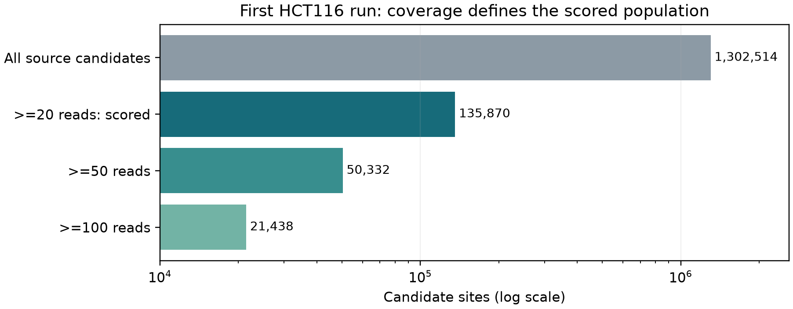
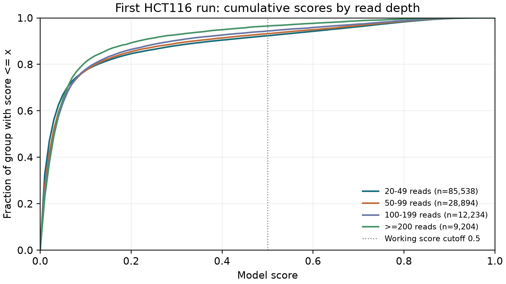

# First genuine SG-NEx prediction: coverage and score QC

**Task 2: one complete run out of the agreed 23.** The frozen selected neural
model has generated real scores for `SGNex_Hct116_directRNA_replicate3_run4`. This is a sequencing-run QC and
predicted-score report, not a completed seven-cell-line analysis or a new
accuracy evaluation. No model fitting, calibration or threshold tuning occurs.

## What actually completed

All **1,302,514 source sites and 15,133,352 reads** were checked by
the strict input workflow. Member 4's >=20-read rule retained **135,870
sites (10.431%)**, comprising **10,572,838 reads**. All those reads
were used by the unchanged predictor. **1,166,644 below-20-read sites remain
unscored**, with an explicit QC reason; they are not labelled unmodified or
silently turned into zero scores. No nonfinite read was removed or imputed.

The model is `elgin-cap128-weight3-18epoch-b2d38ff29a91`, fitted only on data0;
SHA256 `b2d38ff29a918cb6213ad7df2c76786c5f56d3640bd055ff179d211b0e979668`. The original three-column export is preserved locally with
full-precision scores, original transcript IDs/positions and no coordinate
shift. Exact source, source-metadata, model, adapter, predictor and output
hashes were checked again for this report.

## How Member 4's findings affect this result

Her run inventory fixes the dataset identity and source population. Every one
of the **135,870 scored keys and its read count** matches her received
coverage matrix exactly. The >=20-read population, the 50,332 sites with
>=50 reads and 21,438 sites with >=100 reads for sensitivity analysis, and the retention of missing/low-depth
observations as unscored all come directly from the agreed analysis design.
These checks make Member 4's work part of actual model-application eligibility
and verification.



These populations are nested. Their sizes describe observed processed
candidate sites, not modified-site counts. Cross-run comparisons still need
eligible matching sites and equal replicate-group weighting after all runs
are available. A single run cannot establish a cell-line effect.

## Actual continuous scores and fixed-cutoff sensitivity

| Population | Sites | Median score | Fraction score >=0.5 | Fraction score >=0.7 | Fraction score >=0.9 |
| --- | --- | --- | --- | --- | --- |
| >=20 reads | 135870 | 0.025120 | 0.070207 | 0.033915 | 0.002149 |
| >=50 reads | 50332 | 0.028948 | 0.059008 | 0.027458 | 0.001411 |
| >=100 reads | 21438 | 0.030685 | 0.047159 | 0.020431 | 0.000980 |

The fractions above mean **fraction of scored sites whose model score meets or exceeds
the stated cutoff**. They are not assay-validated m6A prevalence or measured
modified-molecule fractions. Cutoffs 0.5/0.7/0.9 are fixed reporting/sensitivity
rules; none was selected from these distributions. The >=50/100 rows change
the analysed population, so differences cannot be assigned to coverage alone.



The CDF is evaluated at 101 fixed score-grid points; its groups are disjoint
20-49, 50-99, 100-199 and >=200 reads. It shows score behaviour rather than
classification accuracy. Motif composition, abundance, technical processing
and other differences can confound this descriptive coverage comparison.

## Context support and unusual valid inputs

The actual eligible metadata enumerates **288 seven-mers and 18 central
motifs**, with U encoded as T. All occur in data0, so there are no unseen
canonical contexts in this run. This actual enumeration is distinct from the
earlier audit-only training-support deduction, whose distinct-count field was
left null.

Seen context does not guarantee strong positive-label evidence. **15,708
eligible sites** use AAACC/TAACA/TAACC, whose data0 central-motif positive-label
support is 11/1/2 respectively. The companion `motif_summary.csv` and
`training_support_summary.csv` preserve the full aggregate counts and scores;
sparse support is an evidence limit, not a calibrated uncertainty score or a
reason to remove valid sites. The model shares parameters across contexts.

| Seven-mer support in data0 | Eligible sites | Median score | Fraction score >=0.5 |
| --- | --- | --- | --- |
| 0 positive training labels | 16643 | 0.003515 | 0.000300 |
| 1-19 positive training labels | 71916 | 0.020775 | 0.015852 |
| >=20 positive training labels | 47311 | 0.078911 | 0.177422 |

Training depths span 20-991 reads. This run spans 1-993; exactly
**1 eligible site exceeds the training maximum**. It was retained and
flagged for interpretation, not deleted or used to retrain the frozen model.
All low-depth input records and their QC reasons remain in local metadata.

## Computation and verification

The full adapter measured **466.378s wall** and
**324.047s parent-process CPU excluding the predictor child**. It
includes complete source QC, eligible-input construction, child inference and
export audit. Core inference measured **127.229s wall,
493.406s process CPU and 390.78MiB sampled peak process-tree RSS**.
Its wall overlaps the adapter wall: **do not add them**. The separate earlier
full-input audit measured 117.574s wall; the small 1,024-source-site probe
passed numeric parity with maximum difference 1.49e-08. The probe
is a software check, not an accuracy test. Resource scopes and all source
fingerprints are retained in `summary.json`.

No model inference was repeated by this reporter. It verified all adapter
receipt files, selected model/core identity, original input hash, full CSV
contents, complete QC metadata, training-support joins and Member 4's exact
eligible key/count population. No compatible independent SG-NEx assay labels
were supplied, so accuracy, ROC/PR, calibration, biological modification
fractions, other RNA marks or differential cell-line conclusions are not
claimed. Exact reference/event offsets remain unverified; literal coordinates
are preserved and no genomic/UTR mapping is performed.

## Reproduce from the repository root

The actual interpreter on this laptop is
`../advanced_model/.venv/Scripts/python.exe`; use `python` in the pinned model
environment on another machine. The first-run commands were:

```text
python -B sgnex_analysis/scripts/download_signal_inputs.py --dest sgnex_analysis/outputs/signals --run-id SGNex_Hct116_directRNA_replicate3_run4
python -B sgnex_analysis/scripts/audit_elgin_input.py --input sgnex_analysis/outputs/signals/SGNex_Hct116_directRNA_replicate3_run4/data.json --run-id SGNex_Hct116_directRNA_replicate3_run4 --output sgnex_analysis/outputs/preflight/first_full_input_audit.json
python -B -u sgnex_analysis/scripts/predict_elgin_run.py --input sgnex_analysis/outputs/signals/SGNex_Hct116_directRNA_replicate3_run4/data.json --run-id SGNex_Hct116_directRNA_replicate3_run4 --output sgnex_analysis/outputs/predictions/SGNex_Hct116_directRNA_replicate3_run4.csv --min-reads 20 --threads 4
python -B sgnex_analysis/scripts/report_first_prediction.py
```

The report command requires the completed local evidence and refuses an
existing nonempty output directory. Use `--output-dir` with a fresh path for a
later check. The first download/input-audit/prediction commands describe real
prior work and should not overwrite retained outputs. Per-site CSVs, all-site
QC metadata, eligible original JSON, raw signal and logs remain under ignored
`sgnex_analysis/outputs/`; the public report contains aggregates only.

**Still pending:** completion of the remaining agreed runs, replicate-aware
common-site analyses and coverage/context sensitivity, supported biological
interpretation, genuine-score Explorer integration and final scientific report.
